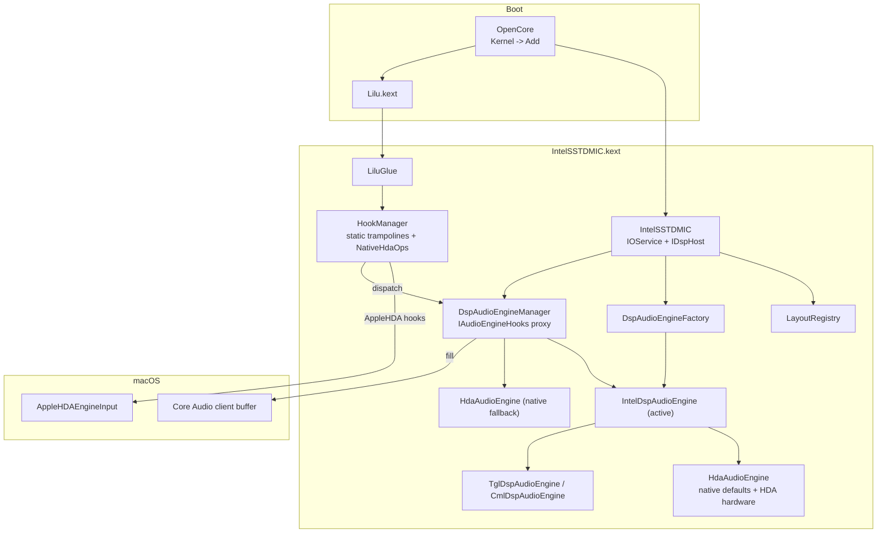
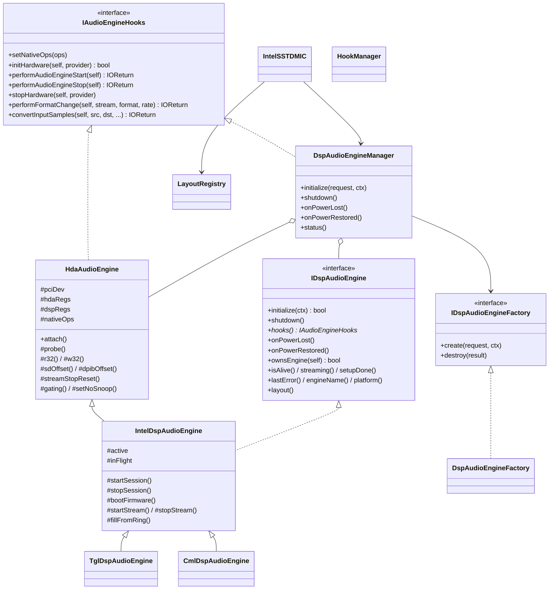
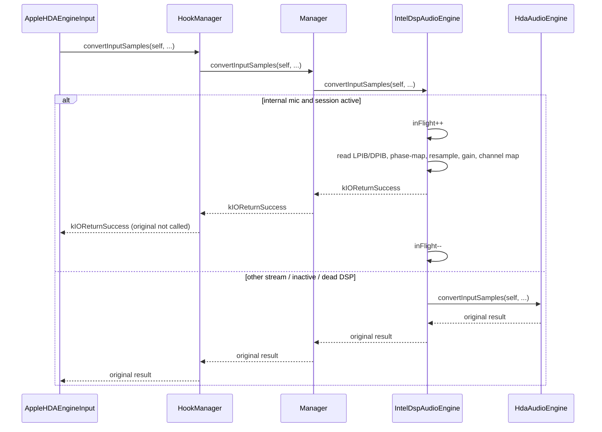

# IntelSSTDMIC — System Architecture and Developer Guide

English | [中文](architecture_CN.md)

## 1. Scope and constraints

IntelSSTDMIC exposes the cAVS/SOF PDM microphone array as AppleHDA's native **Internal
Microphone**. It never creates a virtual device and never touches other inputs or outputs.

| Constraint | Consequence |
| --- | --- |
| Lilu plugin injected by OpenCore (`Kernel -> Add`). | No readable bundle at runtime. Firmware and layouts are compiled into the binary; the build also copies every layout into the kext `Info.plist`. |
| AppleHDA owns the HDA controller and its MSI. | All DSP register handshakes are bounded polling loops; no interrupt is registered. |
| Only the internal microphone is driven. | Every hook checks the engine's `IOAudioEngineDescription`/tag; everything else calls the original AppleHDA function. |
| Lifecycle hooks are synchronous. | No event queue or timer. Start/stop hooks call the native function and then run the DSP work on the same thread. |
| The sample path must never allocate or block. | `active` + `inFlight` gate the ring; teardown drains fills before releasing buffers. |
| Kernel C++17, no RTTI/exceptions/STL. | Plain classes, explicit ownership, no hot engine swapping. |

## 2. Layering

| Layer | Types | Responsibility |
| --- | --- | --- |
| Configuration | `LayoutConfig`, `LayoutRegistry` | Layout id → platform/engine, firmware identity, microphone geometry, HDA formats. Embedded defaults plus optional `Layouts.plist`. |
| Hardware + native | `HdaAudioEngine`, `NativeHdaOps`, `IAudioEngineHooks` | HDA BAR/register/capability/DMA-descriptor access; default hook methods that call the original AppleHDA functions. |
| DSP | `IDspAudioEngine`, `IntelDspAudioEngine`, `TglDspAudioEngine`, `CmlDspAudioEngine` | Common SOF loader, IPC3, host ring, session state and sample conversion; platform subclasses only add identity/core mask/firmware. |
| Creation | `IDspAudioEngineFactory`, `DspAudioEngineFactory`, `DspEngineCreateRequest/Result` | The single creation seam. Configuration is one strategy; on failure it creates a native `HdaAudioEngine`. |
| Dispatch | `DspAudioEngineManager` | Implements `IAudioEngineHooks`, forwards to the created engine hooks or the native fallback. |
| Routing | `HookManager` | Static AppleHDA trampolines, Lilu routes, captured `NativeHdaOps`. |
| Service | `IntelSSTDMIC` | IOService, layout selection, manager/factory ownership, PM, ioreg diagnostics. Implements `IDspHost`. |

## 3. Component diagram



## 4. Type model



### Key types

| Type | Purpose |
| --- | --- |
| `NativeHdaOps` | Function-pointer table with the original AppleHDA implementations captured by the routes. |
| `IAudioEngineHooks` | AppleHDA-shaped hook interface; `self` is AppleHDA's object. |
| `HdaAudioEngine` | Default native behaviour + HDA hardware access. The Manager's native fallback only uses the hooks; it never attaches hardware. |
| `IDspAudioEngine` | Control/status contract used by the Manager and factory. |
| `IntelDspAudioEngine` | Common DSP implementation; owns ring buffers, IPC, session state and the fill path. |
| `TglDspAudioEngine` / `CmlDspAudioEngine` | cAVS 2.5 / 1.8 identity, core mask, embedded firmware image. |
| `DspAudioEngineManager` | Proxy implementing `IAudioEngineHooks`; owns the factory result and forwards. |
| `DspAudioEngineFactory` | Creates the concrete engine from a layout; on failure creates native fallback and retains an error string. |
| `LayoutRegistry` | Parses `Layouts.plist`, merges built-in layouts, resolves boot-argument selection. |
| `HookManager` | Installs Lilu routes, fills `NativeHdaOps`, holds the static hook trampolines. |
| `IntelSSTDMIC` | IOService, layout selection, PM, ioreg publishing. |

## 5. Runtime

### 5.1 Startup

1. The kext loads via the early `IOResources` personality; the PCI personality attaches to the
   Intel HDA controller.
2. `IntelSSTDMIC::start` loads the layout registry, resolves the layout, creates the manager and
   calls `factory.create()`.
3. The factory creates `TglDspAudioEngine`/`CmlDspAudioEngine`, calls `initialize()` and returns it.
   On any failure it creates a native `HdaAudioEngine` and stores `CreateError`.
4. `HookManager` routes AppleHDA symbols when AppleHDA loads and injects `NativeHdaOps` into the
   manager and engine.

### 5.2 Session flow (synchronous)

```
AppleHDA initHardware
  → HookManager trampoline
    → Manager::initHardware
      → HdaAudioEngine::initHardware (original AppleHDA)
      → IntelDspAudioEngine::handleDeviceEvent(Init)
         1. noteEngine(self): description/tag/streams
         2. initializeDsp(): hold power, probe, map BAR4, boot firmware

AppleHDA performAudioEngineStart
  → HookManager trampoline
    → Manager::performAudioEngineStart
      → HdaAudioEngine::performAudioEngineStart (original AppleHDA)
      → IntelDspAudioEngine::handleDeviceEvent(Start)
         1. noteEngine(self)
         2. startSession(self):
              clamp capture stream index to numInputs
              find descriptor by tag (RUN not required)
              sync FMT/CBL geometry
              start DSP capture pipeline
              active = true; sessionState = streaming
```

`performAudioEngineStop` mirrors this: original stop first, then the session drains `inFlight` and
stops the pipeline; firmware stays powered. `stopHardware` additionally powers the core down.
Format changes call the original and refresh the cached HDA geometry.

The Manager calls `handleDeviceEvent` synchronously by default. The workloop, event queue and
`-sstdmicasync` fallback are retained: with that boot argument the same events are posted to the
workloop instead.

Only `DevShortNameIMic` engines are processed. `convertInputSamples` checks the cached
`AppleHDAStream` pointers; anything else goes to the original converter.

### 5.3 Fill path



The fill path takes no locks and performs no allocation or logging. Teardown sets `active=false`
and waits for `inFlight==0` before freeing the ring.

### 5.4 Power

The service joins AppleHDA's PM tree. While recording it holds state 1; `setPowerState(0)` calls
`Manager::onPowerLostSync()` synchronously, which stops the session and powers the core down. On
wake `setPowerState(1)` calls `onPowerRestored()`; if the core lost HPSRAM the firmware is reloaded
immediately, and a still-running native engine restarts the DSP session. `holdPower` only waits
briefly because hooks run inside AppleHDA callbacks.

## 6. Hooked functions

| AppleHDA symbol | Hook behaviour |
| --- | --- |
| `AppleHDAEngine::convertInputSamples` | Internal mic: DSP fill; otherwise original. |
| `AppleHDAEngineInput::initHardware` | Original, then cache engine/tag/streams, initialize DSP and load firmware. |
| `AppleHDAEngine::performAudioEngineStart` | Original, then start DSP recording. |
| `AppleHDAEngineInput::performAudioEngineStop` | Original, then stop DSP recording. |
| `AppleHDAEngineInput::stopHardware` | Original teardown, then stop session, power down and release the cache. |
| `AppleHDAEngineInput::performFormatChange` | Original, then refresh HDA geometry. |

All targets are static functions; the Manager is reached through a static pointer. If no manager
exists the trampoline calls `NativeHdaOps` directly.

## 7. Layout configuration

`-sstdmiclayout` is the master switch. `auto` selects `-sstdmicprofile`/`-sstdmicmodel` when
present, otherwise the detected platform default; `0` creates the native `HdaAudioEngine` directly;
`N > 0` creates layout N and falls back to native on failure/unknown id. If the argument is absent
the driver installs no DSP hooks and stays fully native.

Layout ids start at 1 (0 is reserved for disabled). Built-in layouts: 1 (TGL X13 stereo), 2 (CML
X1C7), 3 (TGL X13 mono). All entries in `Layouts/Layouts.plist` are compiled into the binary and
copied into the kext `Info.plist` (`IntelSSTDMLayouts`, `IntelSSTDMLayoutIDs`) at build time.

Key fields: `platform`, `engine`, `micCount`, `codecs` (metadata), `dsp.{firmware,streamIndex,
pcmTag,pipelineId,sourceRate,sourceChannels,sourceBits,gain}`, `hda.{outputChannels,channelMap,
sampleRates,bits,safetyFrames}`. `sourceChannels` must be 4 and `sourceBits` 32 for the current SOF
pipeline; HDA sample rates are handled by resampling.

## 8. Developer guide

### Add a microphone model (no new class)

Add a layout entry with the same platform/engine, set mic count, channel map, stream/tag, gain and
HDA formats. Select it with `-sstdmiclayout`. Do not create a model-named subclass.

### Add a DSP platform engine

1. Add a `PlatformFamily` value and detection if needed.
2. Subclass `IntelDspAudioEngine`, implement `platformName()`, `platform()`, `engineName()`,
   `firmwareImage()`, `targetCoreMask()` (and capture defaults if different).
3. Add the selector mapping in `DspAudioEngineFactory::create()` and the PCI id in
   `IntelSSTDMIC::detectPlatform()` / `Info.plist`.
4. Compile the signed firmware into the binary (`kext/Firmware/...`, Makefile/gen-fw) and return it
   from `firmwareImage()`.
5. Add a built-in layout and a sample `Layouts.plist` entry.
6. Test with the diagnostics checklist.

Subclasses are for DSP behaviour differences (boot/IPC/power), not for laptop models.

### Add or replace firmware

The image must be an Intel production-signed SOF `.ri` (starts with `XMan`). Put it under
`kext/Firmware/<TGL|CML>`; `tools/gen-fw.py` compiles both images in. A new platform image requires
a new generated array and a subclass `firmwareImage()` override. The layout's `firmware` field is
informational for the current engine classes.

### Add a new hook

1. Add a static trampoline + route symbol in `HookManager` and a field in `NativeHdaOps`.
2. Add the method to `IAudioEngineHooks`.
3. Implement the default in `HdaAudioEngine` (call the original) and override in `IntelDspAudioEngine`
   if DSP must act. `DspAudioEngineManager` calls it synchronously by default; `-sstdmicasync`
   restores workloop dispatch.
4. Keep the hook static and pass AppleHDA's `self` explicitly.

### Diagnostics checklist

`ioreg -l -c IntelSSTDMIC`:

- `LayoutId`, `EngineClass`, `DspActive`, `LayoutDisabled`, `CreateError`
- `DspAlive`, `Streaming`, `SetupDone`, `LastError`
- `ImicTag`, `ImicStreams`, `HookFills`, `HookFrames`
- `HookRouteOk`, `HookRouteEngine`, `Log`

Healthy recording: `EngineClass=TglDspAudioEngine`, `DspActive=true`, `Streaming=true`,
`HookRouteOk=1`, fills rising. Creation failure: `EngineClass=native`, `DspActive=false`,
`CreateError` set, AppleHDA behaviour unchanged.

### Conventions

- Backend subclasses by DSP platform/codec/mic family, never laptop model.
- Only the internal microphone may be intercepted.
- No allocation, logging or locks in `convertInputSamples`.
- Lifecycle hooks run synchronously by default; the event loop is retained as the `-sstdmicasync`
  fallback. No periodic descriptor scans.
- Factory is the only creation seam; configuration is one creation strategy.
- Missing lifecycle symbols never block the data hook or the native path.
