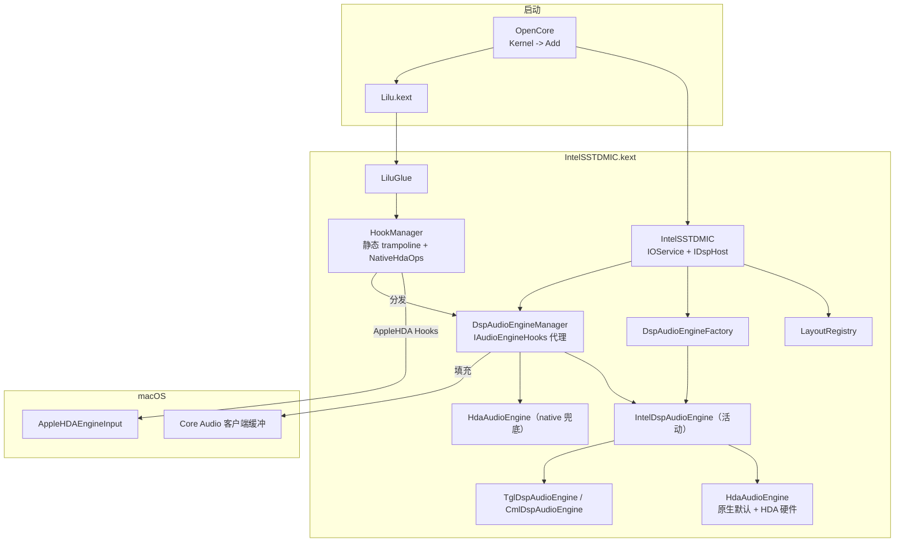
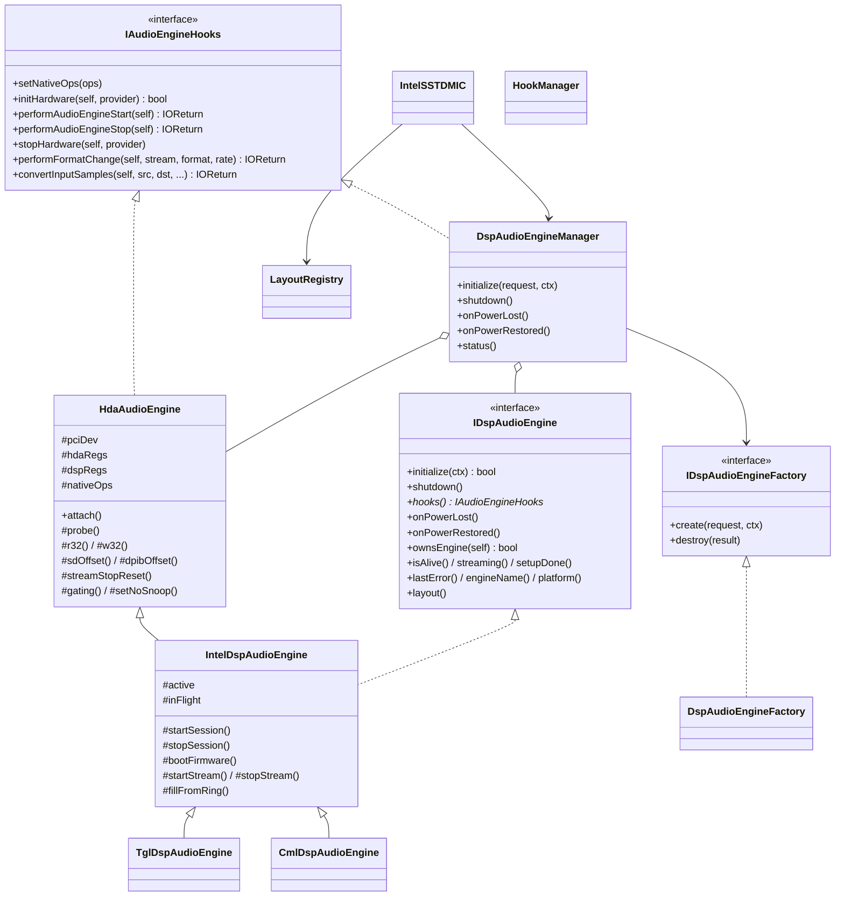
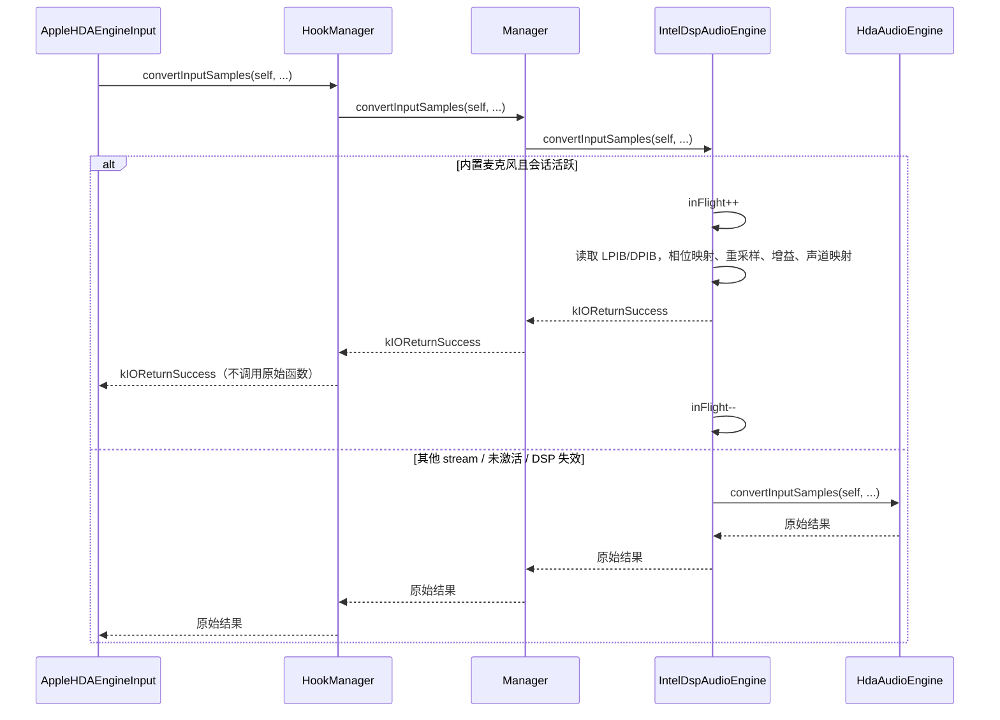

# IntelSSTDMIC — 系统架构与开发指南

[English](architecture.md) | 中文

## 1. 范围与设计约束

IntelSSTDMIC 把 cAVS/SOF 的 PDM 麦克风阵列接入 AppleHDA 原生的 **内置麦克风**。它不创建虚拟
声卡，也不干涉其他输入/输出引擎。

| 约束 | 结果 |
| --- | --- |
| Lilu 插件由 OpenCore（`Kernel -> Add`）注入。 | 运行时没有可读 bundle。固件和 layout 都编译进二进制；构建时还会把所有 layout 写入 kext 的 `Info.plist`。 |
| HDA 控制器和 MSI 属于 AppleHDA。 | DSP 寄存器握手使用有界轮询，不注册中断。 |
| 只驱动内置麦克风。 | 每个 Hook 都检查 `IOAudioEngineDescription`/tag，其他引擎调用原始 AppleHDA 函数。 |
| 生命周期 Hook 默认同步执行。 | Hook 先调用原生函数，再在同一线程执行 DSP 工作。事件队列/workloop 保留；加 `-sstdmicasync` 可回退到异步分发。 |
| 采样路径不能分配、不能阻塞。 | `active` + `inFlight` 控制 ring；teardown 等待 fill 退出后再释放缓冲。 |
| 内核 C++17，无 RTTI/异常/STL。 | 普通类、显式所有权、运行期不热切换引擎。 |

## 2. 分层

| 层 | 类型 | 职责 |
| --- | --- | --- |
| 配置 | `LayoutConfig`、`LayoutRegistry` | layout id → 平台/引擎、固件标识、麦克风几何、HDA 格式；内置默认 + 可选 `Layouts.plist`。 |
| 硬件 + 原生 | `HdaAudioEngine`、`NativeHdaOps`、`IAudioEngineHooks` | HDA BAR/寄存器/capability/descriptor 访问；默认 Hook 调用 AppleHDA 原始函数。 |
| DSP | `IDspAudioEngine`、`IntelDspAudioEngine`、`TglDspAudioEngine`、`CmlDspAudioEngine` | 公共 SOF 加载、IPC3、host ring、会话状态和采样转换；平台子类只添加身份/core mask/固件。 |
| 创建 | `IDspAudioEngineFactory`、`DspAudioEngineFactory`、`DspEngineCreateRequest/Result` | 唯一创建缝合点；配置只是其中一种策略；失败时创建 native `HdaAudioEngine`。 |
| 分发 | `DspAudioEngineManager` | 实现 `IAudioEngineHooks`，转发给活动引擎或 native 兜底。 |
| 路由 | `HookManager` | 静态 AppleHDA trampoline、Lilu 路由、`NativeHdaOps`。 |
| 服务 | `IntelSSTDMIC` | IOService、layout 选择、Manager/Factory 生命周期、PM、ioreg。实现 `IDspHost`。 |

## 3. 组件图



## 4. 类型模型



### 关键类型

| 类型 | 作用 |
| --- | --- |
| `NativeHdaOps` | 保存 Lilu 路由捕获的 AppleHDA 原始函数指针。 |
| `IAudioEngineHooks` | AppleHDA 形状的 Hook 接口；`self` 是 AppleHDA 自己的对象。 |
| `HdaAudioEngine` | 默认原生行为 + HDA 硬件访问。Manager 的 native 兜底只使用 Hook 默认实现，不 attach 硬件。 |
| `IDspAudioEngine` | Manager/Factory 使用的控制和状态接口。 |
| `IntelDspAudioEngine` | 公共 DSP 实现：ring、IPC、会话状态、采样路径。 |
| `TglDspAudioEngine` / `CmlDspAudioEngine` | cAVS 2.5 / 1.8 身份、core mask、内嵌固件。 |
| `DspAudioEngineManager` | 实现 `IAudioEngineHooks` 的代理；持有 Factory 结果并转发。 |
| `DspAudioEngineFactory` | 按 layout 创建具体引擎；失败时创建 native 兜底并保留错误字符串。 |
| `LayoutRegistry` | 解析 `Layouts.plist`、合并内置 layout、解析启动参数。 |
| `HookManager` | 安装 Lilu 路由、填充 `NativeHdaOps`、静态 trampoline。 |
| `IntelSSTDMIC` | IOService、layout 选择、PM、ioreg 发布。 |

## 5. 运行时

### 5.1 启动

1. kext 通过早期 `IOResources` personality 加载，PCI personality 匹配 Intel HDA 控制器。
2. `IntelSSTDMIC::start` 读取 layout 注册表、解析 layout、创建 Manager，并调用
   `factory.create()`。
3. Factory 创建 `TglDspAudioEngine`/`CmlDspAudioEngine`，调用 `initialize()`。任何失败都会改为
   创建 native `HdaAudioEngine` 并记录 `CreateError`。
4. AppleHDA 加载时 `HookManager` 路由符号，并把 `NativeHdaOps` 注入 Manager/引擎。

### 5.2 会话流程（同步）

```
AppleHDA initHardware
  → HookManager trampoline
    → Manager::initHardware
      → HdaAudioEngine::initHardware（原始 AppleHDA）
      → IntelDspAudioEngine::handleDeviceEvent(Init)
         1. noteEngine(self)：描述/tag/streams
         2. initializeDsp()：holdPower、probe、映射 BAR4、加载固件

AppleHDA performAudioEngineStart
  → HookManager trampoline
    → Manager::performAudioEngineStart
      → HdaAudioEngine::performAudioEngineStart（原始 AppleHDA）
      → IntelDspAudioEngine::handleDeviceEvent(Start)
         1. noteEngine(self)
         2. startSession(self)：
              将采集 stream 索引钳制到 numInputs
              按 tag 查找 descriptor（不要求 RUN）
              同步 FMT/CBL 几何
              启动 DSP 采集 pipeline
              active = true；sessionState = streaming
```

`performAudioEngineStop` 对称：先调用原生 stop，再等待 `inFlight` 归零并停止 pipeline；固件保持
供电。`stopHardware` 额外给 core 下电。格式变化先调用原生，再刷新缓存的 HDA 几何。

Manager 默认同步调用 `handleDeviceEvent`；workloop/事件队列仍保留，加 `-sstdmicasync` 可回退为
异步分发。

只处理 `DevShortNameIMic` 引擎。`convertInputSamples` 检查缓存的 `AppleHDAStream` 指针，其他
stream 一律调用原始转换函数。

### 5.3 采样路径



fill 路径不加锁、不分配、不写日志。teardown 先 `active=false`，等待 `inFlight==0`，再释放 ring。

### 5.4 电源

Service 加入 AppleHDA 的 PM 树。录音期间保持 state 1；`setPowerState(0)` 同步调用
`Manager::onPowerLostSync()`，停止会话并给 core 下电。唤醒时 `setPowerState(1)` 调用
`onPowerRestored()`；HPSRAM 丢失时立即重新加载固件，原生引擎仍在运行则重启 DSP 会话。
`holdPower` 只做很短等待，因为它运行在 AppleHDA 的回调里。

## 6. Hook 列表

| AppleHDA 符号 | Hook 行为 |
| --- | --- |
| `AppleHDAEngine::convertInputSamples` | 内置麦克风：DSP 填充；否则原始。 |
| `AppleHDAEngineInput::initHardware` | 原始，然后缓存引擎/tag/streams、初始化 DSP 并加载固件。 |
| `AppleHDAEngine::performAudioEngineStart` | 原始，然后启动 DSP 录音。 |
| `AppleHDAEngineInput::performAudioEngineStop` | 原始，然后停止 DSP 录音。 |
| `AppleHDAEngineInput::stopHardware` | 原始 teardown，然后停止会话、给 core 下电并释放缓存。 |
| `AppleHDAEngineInput::performFormatChange` | 原始，然后刷新 HDA 几何。 |

所有目标都是静态函数；Manager 通过静态指针访问。没有 Manager 时 trampoline 直接调用
`NativeHdaOps`。

## 7. Layout 配置

`-sstdmiclayout` 是唯一开关。`auto` 优先使用 `-sstdmicprofile`/`-sstdmicmodel`，否则使用探测到的
平台默认 layout；`0` 直接创建 native `HdaAudioEngine`；`N > 0` 创建 layout N，找不到或创建失败时
记录日志并回退 native。不设置该参数时驱动不安装 DSP Hook，完全走原生路径。

layout id 从 1 开始（0 保留给关闭）。内置 layout：1（TGL X13 立体声）、2（CML X1C7）、3（TGL X13
单声道）。`Layouts/Layouts.plist` 的所有条目在构建时编译进二进制，并写入 kext 的 `Info.plist`
（`IntelSSTDMLayouts`、`IntelSSTDMLayoutIDs`）。

关键字段：`platform`、`engine`、`micCount`、`codecs`（元数据）、`dsp.{firmware,streamIndex,
pcmTag,pipelineId,sourceRate,sourceChannels,sourceBits,gain}`、`hda.{outputChannels,channelMap,
sampleRates,bits,safetyFrames}`。当前 SOF pipeline 要求 `sourceChannels=4`、`sourceBits=32`；
HDA 采样率由软件重采样处理。

## 8. 开发指南

### 新增麦克风型号（不新建类）

添加一个 layout：相同 platform/engine，填写麦克风数量、channel map、stream/tag、增益、HDA 格式。
用 `-sstdmiclayout` 选择。不要创建以型号命名的子类。

### 新增 DSP 平台引擎

1. 如有需要，增加 `PlatformFamily` 和检测逻辑。
2. 继承 `IntelDspAudioEngine`，实现 `platformName()`、`platform()`、`engineName()`、
   `firmwareImage()`、`targetCoreMask()`（必要时还有 capture 默认值）。
3. 在 `DspAudioEngineFactory::create()` 中加选择器映射，在
   `IntelSSTDMIC::detectPlatform()` / `Info.plist` 中加 PCI id。
4. 把签名固件编进二进制（`kext/Firmware/...`、Makefile/gen-fw），由 `firmwareImage()` 返回。
5. 添加内置 layout 和 `Layouts.plist` 示例。
6. 按诊断清单测试。

子类只用于 DSP 行为差异（boot/IPC/电源），不是笔记本型号。

### 提交或替换固件

镜像必须是 Intel 生产签名的 SOF `.ri`（以 `XMan` 开头）。放到 `kext/Firmware/<TGL|CML>`，
`tools/gen-fw.py` 会把镜像编进二进制。新平台需要新的生成数组和子类 `firmwareImage()` 覆盖。
当前 layout 的 `firmware` 字段对引擎只起标识作用。

### 新增 Hook

1. 在 `HookManager` 增加静态 trampoline + 路由符号，并在 `NativeHdaOps` 增加字段。
2. 在 `IAudioEngineHooks` 增加方法。
3. 在 `HdaAudioEngine` 实现默认（调用原始），需要 DSP 行为时在 `IntelDspAudioEngine` 覆写。
   `DspAudioEngineManager` 默认同步调用；`-sstdmicasync` 可回退到 workloop 异步分发。
4. 所有 Hook 必须是静态函数，显式传入 AppleHDA 的 `self`。

### 诊断清单

`ioreg -l -c IntelSSTDMIC`：

- `LayoutId`、`EngineClass`、`DspActive`、`LayoutDisabled`、`CreateError`
- `DspAlive`、`Streaming`、`SetupDone`、`LastError`
- `ImicTag`、`ImicStreams`、`HookFills`、`HookFrames`
- `HookRouteOk`、`HookRouteEngine`、`Log`

正常录音：`EngineClass=TglDspAudioEngine`、`DspActive=true`、`Streaming=true`、
`HookRouteOk=1`、fills 增长。创建失败：`EngineClass=native`、`DspActive=false`、
`CreateError` 给出原因，AppleHDA 行为不变。

### 约定

- 子类按 DSP 平台/codec/麦克风家族划分，绝不按笔记本型号。
- 只接管内置麦克风。
- `convertInputSamples` 禁止分配、日志和锁。
- 生命周期 Hook 默认同步执行；事件循环仅作为 `-sstdmicasync` 回退保留，不做周期性 descriptor 扫描。
- Factory 是唯一创建缝合点；配置只是一种创建策略。
- 生命周期符号缺失不能阻塞数据 Hook 或 native 路径。
